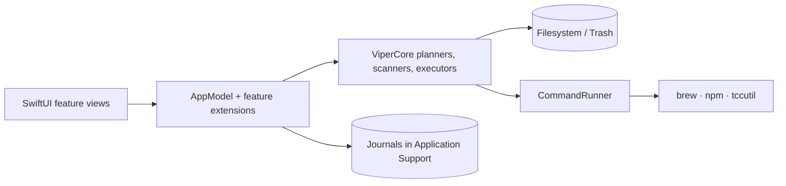

# Viper

A native macOS maintenance app that shows what is using your disk and memory, then removes, cleans, updates, or installs software only after you review each change.

## Overview

Viper is for everyday Mac users and developers who want CleanMyMac/AppCleaner/Ninite-style maintenance without handing control to a black box. Every consequential action follows the same pattern: discover → explain → select → preview → journal → revalidate → execute → report. Viper starts in **read-only mode**: it scans and checks, but nothing changes until you enable reviewed changes in Settings.

Core use cases:

- Find what is taking space in a folder and move large files to the Trash.
- Uninstall an app, Homebrew package, or global npm package together with its confidently matched support files.
- Find junk (caches, logs, temp files, Xcode data) and leftovers from apps that are no longer installed.
- Find idle apps, background processes, and forgotten dev servers holding memory, and quit them.
- Update Homebrew and npm packages, and find App Store updates.
- Set up a Mac from a curated catalog of apps and command-line tools.

## Current status

**Beta, version 1.0.0.** Every page described below works, with 136 unit tests on the core logic. Before a public release, Viper still needs:

- Developer ID signing and notarization.
- UI and accessibility testing.
- Real package-manager installs, updates, and removals tested on a disposable Mac.

See [Known limitations](#known-limitations).

## Core features

| Page | What it does |
| --- | --- |
| Overview | Disk capacity, last scan summary, and shortcuts to each page. |
| Storage | Scans a chosen folder for a proportional space map, a category breakdown, and its 100/500/1,000 largest files. You can reveal files in Finder or review moving them to the Trash. Protected locations can't be selected. |
| Uninstaller | Lists apps in `/Applications` and `~/Applications`, Homebrew formulae and casks, and global npm packages. Reviews the app or package and its related files (preferences, containers, caches, logs, LaunchAgents), each with evidence and warnings. |
| Junk & Leftovers | *Junk*: caches, logs, old temp files, Xcode DerivedData, simulator caches, npm cache. Anything belonging to an open app is kept. *Leftovers*: files whose owning app is no longer installed. Nothing is preselected by default. |
| Memory | Takes two process samples two seconds apart. Finds idle windowless apps, busy background processes, and localhost dev servers with no connections. Apps get a normal Quit and processes get SIGTERM. Force quit is offered only after a graceful stop fails. |
| Updates | Checks Homebrew, global npm, and App Store apps. Homebrew and npm updates run one at a time and are verified afterwards. App Store results open the store listing. |
| Privacy | Opens each Privacy & Security category in System Settings. Can reset one app's permissions with Apple's `tccutil`. |
| Discover & Install | A built-in, validated catalog of 134 apps and tools with starter collections. Detects what's already installed and queues Homebrew/npm installs after a revalidating review. App Store and vendor-only apps open externally. |
| Settings | Read-only/reviewed-changes mode, preselection, scan folders and exclusions, theme (Space or Website), menu-bar item, and update sources. Also shows removal history and journal recovery. |

## Tech stack

- **Language:** Swift (tools 5.9, builds with Swift 6.x), Swift Package Manager. No third-party dependencies.
- **UI:** SwiftUI, with AppKit for windows, panels, Finder/Trash handoff, and `NSRunningApplication`.
- **Platform:** macOS 14+. Local builds are arm64; distribution builds are universal.
- **External tools invoked:** `brew`, `npm`, `/usr/bin/tccutil`, `/bin/launchctl`. Each is called with a fixed argument array; nothing goes through a shell. Open-file and process data comes from libproc, and Apple-signature checks use the Security framework.
- **Network:** only when you start an action. This means Homebrew/npm metadata, the iTunes Search API for App Store updates, and package installs.
- **Persistence:** settings in `UserDefaults`; JSON journals in `~/Library/Application Support/Viper`; a metadata cache in `~/Library/Caches/Viper`.

## Architecture

There are two SwiftPM targets:

- **`ViperCore`** is a library with all domain logic: scanning, ownership and removal policy, planners, executors, package providers, the catalog, journals, and process execution. It has no UI and is what the tests cover.
- **`Viper`** is the SwiftUI app. One main-actor `AppModel` holds app state. Each feature adds its logic in an `extension AppModel` file next to its views.



For details, see [docs/ARCHITECTURE.md](docs/ARCHITECTURE.md).

## Repository structure

```
Package.swift                 SwiftPM manifest (ViperCore, Viper, ViperCoreTests)
Sources/
├── Viper/                    The macOS app (SwiftUI)
│   ├── App/                  Entry point, AppModel, settings, on-disk paths
│   ├── DesignSystem/         Theme/palette, controls, progress indicators
│   └── Features/<Page>/      One folder per page: views + its AppModel extension
└── ViperCore/                Domain logic, no UI
    ├── Storage/              Folder scanning and capacity
    ├── Inventory/            Installed apps, Homebrew and npm packages
    ├── Removal/              Removal policy, uninstall planner/executor, junk & leftovers, journals
    ├── Catalog/              Built-in catalog, install planner, install journal
    ├── Packages/             Package providers, update checks, upgrades, permission reset
    ├── Memory/               Process sampling, memory advisor, stopper, usage history
    └── Support/              CommandRunner, shell environment, link allowlist, progress, journal store
Tests/ViperCoreTests/         XCTest suites using temporary fixture directories
Resources/                    Info.plist, bundled catalog icons and their sources
scripts/                      App bundling, icon rendering, catalog-icon collection
docs/                         Architecture, development, agent guide, decisions
```

## Getting started

Prerequisites: macOS 14 or later and Xcode (or the Xcode Command Line Tools) with the license accepted (`sudo xcodebuild -license accept`).

```sh
git clone https://github.com/srikantmehra57/Viper.git
cd Viper
swift test                      # build and run the unit tests
swift run Viper                 # run the app directly from the package (development)
bash scripts/build-app.sh       # build a release dist/Viper.app with a local signature
open dist/Viper.app
```

There is nothing to install beyond the toolchain, because there are no package dependencies. You can also open `Package.swift` in Xcode and run the `Viper` scheme.

## Environment variables

The app reads none. Two are used only by `scripts/build-app.sh release --distribution`:

| Variable | Purpose |
| --- | --- |
| `VIPER_SIGN_IDENTITY` | Developer ID Application signing identity, e.g. `Developer ID Application: Name (TEAMID)`. |
| `VIPER_NOTARY_PROFILE` | `notarytool` keychain profile created with `xcrun notarytool store-credentials`. |

Never commit either value or any certificate.

## Development workflow

| Task | Command |
| --- | --- |
| Build (also the type check) | `swift build` |
| Test | `swift test` |
| Run | `swift run Viper` |
| Release build | `swift build -c release` |
| App bundle | `bash scripts/build-app.sh [debug\|release] [--skip-build] [--distribution]` |
| Clean | `swift package clean` (build output is in `.build/` and `dist/`) |

No linter or formatter is configured. Keep to the style of the file you're editing. CI (`.github/workflows/test.yml`) runs `swift test` and a release build on macOS 14. See [docs/DEVELOPMENT.md](docs/DEVELOPMENT.md).

## Architecture principles

- **Read-only by default.** Every mutation checks `allowReviewedChanges` and that no journal needs review. It checks again before each item, not just at confirmation.
- **Review, then revalidate.** Filesystem items carry an identity and fingerprint taken at review time. The executor rechecks them immediately before moving anything and skips anything that changed.
- **Trash, never delete.** Files move to the Trash with `FileManager.trashItem`. Emptying the Trash is left to Finder.
- **Packages are removed by their own manager.** Homebrew and npm uninstall, install, and upgrade their own packages. Viper never deletes their files directly.
- **No shell strings.** Commands are a fixed executable plus validated arguments, run with an allowlisted environment.
- **Write-ahead journals.** A removal plan is written before the first change, and each outcome is recorded as it happens.
- **Nothing in the background.** There is no daemon, login item, telemetry, or scheduled scan. The only refresh loop is Memory's 5-second update, which runs only while that page is visible.
- **Logic lives in ViperCore.** Views stay thin, and core logic is unit-tested with temporary fixtures, never real user data.

## Known limitations

- **No admin rights.** System-wide `/Library` items, root-owned apps, and installer-package (`pkg`) casks are reported, not removed or installed.
- **Uninstall finds confidently matched files only.** It doesn't follow package receipts, system extensions, privileged helpers, or vendor-named profile folders, so some data can remain.
- **Junk ownership partly relies on names.** A cache folder that isn't named after a bundle identifier is matched to its app by name. Such items are never preselected, and folders that any process has open are kept.
- **Privacy can't read grants.** macOS has no public API to read per-app grants, so Privacy can only open Settings or reset all of one app's permissions.
- **Only Homebrew and npm tools are listed.** Tools installed with curl scripts, pipx, or cargo aren't shown.
- **Homebrew updates aren't version-pinned.** They run `brew upgrade <name>`; npm installs and updates pin the reviewed version.
- **A double-forking package process can escape a cancel or timeout.** Children that are still in the process tree are stopped and reported.
- **Very large apps are only partly fingerprinted.** For an app with more than 200,000 files, files added deep inside it after review would go to the Trash with it.
- **The catalog is compiled in.** There is no remote catalog refresh or download-size estimate.
- **Little real-world testing so far.** There are no UI or VoiceOver tests, and real installs, updates, and removals have not been run end-to-end on a disposable Mac. Only Apple silicon on a recent macOS has been exercised.
- **Not yet notarized.** Local builds are ad-hoc signed, so Gatekeeper won't treat them as a normal download.

## Documentation

- [docs/ARCHITECTURE.md](docs/ARCHITECTURE.md): system design, data flow, safety model, persistence.
- [docs/DEVELOPMENT.md](docs/DEVELOPMENT.md): setup, commands, testing, release, conventions, pitfalls.
- [docs/AGENT_GUIDE.md](docs/AGENT_GUIDE.md): rules and orientation for AI coding agents and new contributors.
- [docs/DECISIONS.md](docs/DECISIONS.md): architectural decisions and why they were made.
