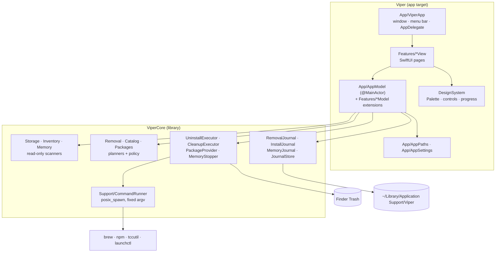
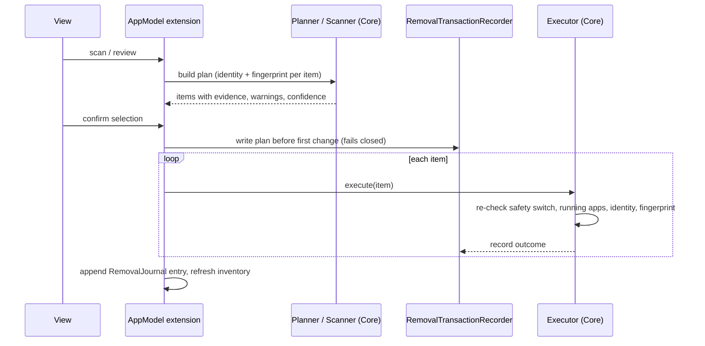

# Architecture

Viper is a single-process native macOS app built from two SwiftPM targets:

| Target | Kind | Responsibility |
| --- | --- | --- |
| `ViperCore` | library | All domain logic: scanning, inventory, ownership/removal policy, planners, executors, package providers, catalog, journals, process execution. No SwiftUI. |
| `Viper` | executable | SwiftUI app: window, menu-bar item, pages, design system, and the `AppModel` coordinator that calls into `ViperCore`. |
| `ViperCoreTests` | tests | XCTest suites for `ViperCore`, using temporary fixture directories and injected executors. |

There are no third-party dependencies, no helper tool, no daemon, and no login item.

## Application lifecycle

1. `ViperApp` (`Sources/Viper/App/ViperApp.swift`) creates one `AppModel`, a single `Window` with id `main`, and an optional `MenuBarExtra`.
2. `AppModel.init` loads `AppSettings` from `UserDefaults` (`viper.settings`) and applies the theme. It then reconciles unfinished removal transactions and quarantines unreadable journals, so any interrupted change is reported at launch. It also loads the last scan summary, probes Full Disk Access (for display only), and starts observing app launch and activation for the Memory usage history.
3. Pages load data on demand when shown. Nothing scans at launch.
4. Quitting is handled by `AppDelegate.applicationShouldTerminate`. Waiting installs and updates are cancelled. A removal, update, or install that is already running finishes and records its outcome before the app terminates. An update check is cancelled and allowed to unwind first. By default, closing the last window quits the app (Settings → close behaviour).

## Module map

### App target (`Sources/Viper`)

| Folder | Contents |
| --- | --- |
| `App/` | `ViperApp` (scene, commands, sidebar, root view), `AppModel` (shared published state, scan/inventory/update-check orchestration, `Page` enum, `bytes(_:)`), `AppSettings` (Codable settings, theme choice), `AppPaths` (every on-disk file location). |
| `DesignSystem/` | `Theme.swift` (`Palette` for the Space and Website themes, `Motion`, cards, tags, headings, gauges, backgrounds), `Controls.swift` (search field, checkbox, select, chips, tabs, disclosure), `ProgressViews.swift` (activity bar, operation progress, queue lines, `ScanPulse`). |
| `Features/Overview` | Landing page tiles. |
| `Features/Storage` | Capacity card, folder scan results, space map (treemap), largest-file list, category bar. |
| `Features/Uninstaller` | App and tool list (`UninstallerView`), review sheet (`UninstallSheet`), `UninstallModel` (planning, execution, put back, journal recovery). |
| `Features/Cleanup` | Junk & Leftovers page, the shared review list, action bar, and result card (also used by Storage's large-file cleanup), and `CleanupModel`. |
| `Features/Memory` | Memory page and `MemoryModel` (sampling, the 5-second live refresh while visible, stopping, `SignatureCache`). |
| `Features/Updates` | Updates page and `UpdatesModel` (serial update queue, install-journal entries). |
| `Features/Privacy` | Privacy shortcuts (`PrivacyCategory`), per-app permission reset, `PrivacyModel`. |
| `Features/Discover` | Catalog browser, detail, review and prerequisite sheets, install queue, `InstallModel`. |
| `Features/Settings` | Settings page, including removal history and journal recovery cards. |

### Core library (`Sources/ViperCore`)

| Folder | Key types |
| --- | --- |
| `Storage/` | `StorageScanner` (cancellable traversal with progress; skips symlinks, other volumes, and cloud-only files; deduplicates hard links), `ScanResult`, `StorageMapItem`, `VolumeCapacity`, `StoredScanSummary`. |
| `Inventory/` | `AppInventory` (app bundles in `/Applications`, `/System/Applications`, `~/Applications`), `CommandLineInventory` (Homebrew formulae/casks, global npm per runtime). |
| `Removal/` | `RemovalPolicy` (protected paths), `RemovalModels` (`FileIdentity`, `RemovalSignature`, `RemovalItem`, …), `UninstallPlanner`, `UninstallExecutor` (Trash moves, package removal, put back), `Cleanup.swift` (`JunkScanner`, `LeftoverScanner`, `StorageCleanup`, `CleanupExecutor`), `OpenFiles` (libproc open-file check), `RemovalJournal` (history plus write-ahead `RemovalTransaction`s). |
| `Catalog/` | `Catalog` schema and validation, `BuiltInCatalog` (JSON compiled into the binary), `InstallPlanner`, `InstallJournal`, `CatalogMetadataCache`. |
| `Packages/` | `PackageProvider` (detect runtimes, metadata, install, verify), `UpdateChecker` (brew/npm outdated, iTunes Search for App Store apps), `Maintenance.swift` (`PackageUpgrade`, `ReviewedChangePolicy`, `PermissionReset`). |
| `Memory/` | `ProcessInventory` (process samples via libproc), `SystemMemory` (VM statistics, pressure), `MemoryAdvisor` (pure decision logic), `MemoryStopper` (re-verified quit/SIGTERM/SIGKILL), `MemoryJournal`, `AppUsage`/`UsageHistory`. |
| `Support/` | `CommandRunner` (posix_spawn with a process group, allowlisted environment, timeout, descendant tracking), `ShellEnvironment`, `ExternalLink` (URL allowlist), `OperationProgress` (parses package-manager output into phases), `JournalStore` (shared quarantine/strict-read helpers). |

## Data and state flow

- **State** lives in one `@MainActor final class AppModel: ObservableObject`. Each feature file extends it (for example `extension AppModel` in `CleanupModel.swift`) and owns a slice of published state (`CleanupState`, `MemoryState`, `UninstallSession`, the install and update queues). Views read the model through `@EnvironmentObject`. There is no other state store.
- **Work** runs in `Task.detached(priority: .utility)` or a plain `Task`. Results are assigned back on the main actor. Long tasks are kept in `*Task` properties so they can be cancelled.
- **Mutual exclusion** uses boolean gates on `AppModel`. `maintenanceBusy` covers uninstalling, cleaning, updating, and freeing memory. `packageOperationBusy` adds installing, detecting, catalog refresh, review, and update checks. A new mutation type must join these gates; don't add a parallel mechanism.
- **Settings** (`AppSettings`) are saved to `UserDefaults` on every change. Turning reviewed changes off, or finding an unreadable journal, cancels waiting installs and updates (see `AppModel.settings.didSet`).

Typical removal flow (Uninstaller, Junk, Leftovers, Storage cleanup):

## Safety model

These rules are enforced in code and covered by tests. Preserve them.

1. **Read-only default.** `AppSettings.allowReviewedChanges` is `false` until the user enables it. Executors call `reviewedChangesAreAllowed()` before each item, not only at confirmation.
2. **Policy before selection.** `RemovalPolicy` blocks system roots, the home root, other users, credentials and sensitive settings, and symlink escapes. System apps, Viper itself, apps outside the application folders, Homebrew dependency formulae, and npm's bundled tools are never offered.
3. **Identity and fingerprint revalidation.** `FileIdentity` (device, inode, mode, size, and modification/change times via `lstat`) and `RemovalSignature` are captured at review. `RemovalSignature` is a bounded recursive metadata fingerprint, capped at 200,000 entries. Any change before the Trash move skips the item. File contents are never read.
4. **Trash only.** `FileManager.trashItem` is used for files, and put back is supported. Viper never empties the Trash.
5. **Packages via their own manager.** `brew uninstall|install|upgrade` and `npm uninstall|install --global <name>@<version>` are run through `CommandRunner` with validated names and no force flags. The result is verified against the provider's inventory afterwards.
6. **Write-ahead journal.** `RemovalTransactionRecorder` persists the plan before the first mutation and each outcome after it. Journals are atomically replaced and fsynced, with mode `0600` in a `0700` folder. An unreadable journal is quarantined and blocks all changes until it is marked reviewed in Settings.
7. **Process safety.** `CommandRunner` never uses a shell. It runs with an allowlisted environment (`SSH_AUTH_SOCK` is deliberately dropped) and its own process group. On cancel or timeout it signals the group and every recorded descendant. If a descendant survives, it reports `CommandError.unsettled`.
8. **Memory stops are re-verified.** Before any signal, `MemoryStopper` re-checks each process's pid, start time, path, and owner, so a recycled pid is never signalled. macOS processes, `KeepAlive` launchd jobs, Viper and its ancestors, the frontmost app, and frequently used apps are never offered.
9. **Links are allowlisted.** `ExternalLink` opens only `https` URLs (no userinfo), `macappstore://` App Store item links, and the compiled System Settings destinations.
10. **The catalog never supplies commands.** Entries are validated at load: exact Homebrew tokens (no taps), npm names (no versions or URLs), and HTTPS sites. Installs use fixed argument arrays and only metadata fetched during the current review can authorize one.

## Persistence

All locations are defined in `Sources/Viper/App/AppPaths.swift`.

| File | Location | Purpose |
| --- | --- | --- |
| Settings | `UserDefaults`, key `viper.settings` | JSON-encoded `AppSettings`. Corrupt data restores defaults and tells the user. |
| `removal-transactions.json` | Application Support/Viper | Write-ahead removal plans and per-item outcomes. Used for crash recovery. |
| `removal-journal.json` | Application Support/Viper | Removal history shown in Settings. |
| `install-journal.json` | Application Support/Viper | Install and update outcomes. |
| `memory-journal.json` | Application Support/Viper | Stopped processes; something that comes back within a day isn't offered again. |
| `app-usage.json` | Application Support/Viper | Local launch/activation counts used by the memory advisor. Saved at most every 30 s and on quit. |
| `scan-summary.json` | Application Support/Viper | Last storage scan summary for Overview and the menu bar. |
| `catalog-metadata.json` | Caches/Viper | Homebrew/npm availability cache. Display only; it never authorizes an install. |

Scan results and inventories are kept in memory only.

## External integrations

| Integration | How | When |
| --- | --- | --- |
| Homebrew | `brew` found by `UpdateChecker.brewExecutables()`; metadata (`info --json=v2`), inventory (`list --versions`), outdated checks, `install`/`upgrade --formula\|--cask`, `uninstall` | On user action only |
| npm | Every detected `npm` runtime; `ls --global --json`, `view`, `outdated --global`, `config get registry`, `install --global name@version`, `uninstall --global` | On user action only |
| App Store | iTunes Search API by bundle id; results open `macappstore://` | Update check only |
| System Settings | `x-apple.systempreferences:` deep links (allowlisted) | Privacy page buttons |
| TCC | `/usr/bin/tccutil reset All <bundle id>` | Privacy reset, after confirmation |
| launchd | `/bin/launchctl` listing to detect `KeepAlive` jobs | Memory scan |
| Finder / Trash | `NSWorkspace` reveal, `FileManager.trashItem`, open Trash | Reveal and cleanup |

## Constraints that shape the design

- **No privileged helper.** Anything that needs root is reported, not forced.
- **No private APIs.** That includes the TCC database.
- **macOS 14 deployment target.** Use only APIs available on macOS 14, or guard them with `if #available`.
- **One window and a main-actor model.** UI updates must happen on the main actor. Heavy work must not run there.
- **Known structural debt.** `AppModel` is a large coordinator, and mutual exclusion is a set of booleans rather than one operation state machine. Filesystem effects are static functions, so tests inject at the executor boundary (trash closures, package outcomes) rather than through a fake filesystem.
